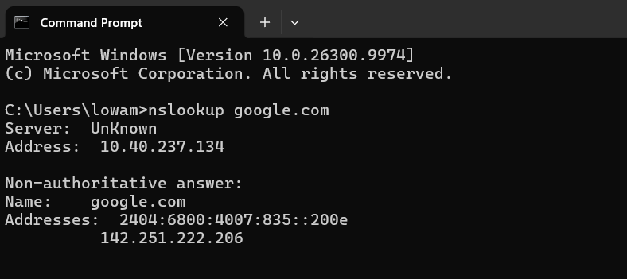
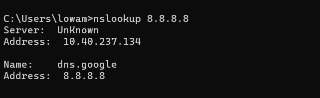
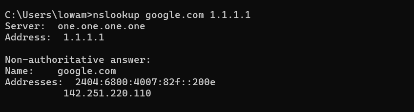
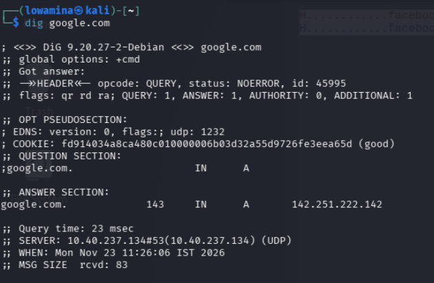
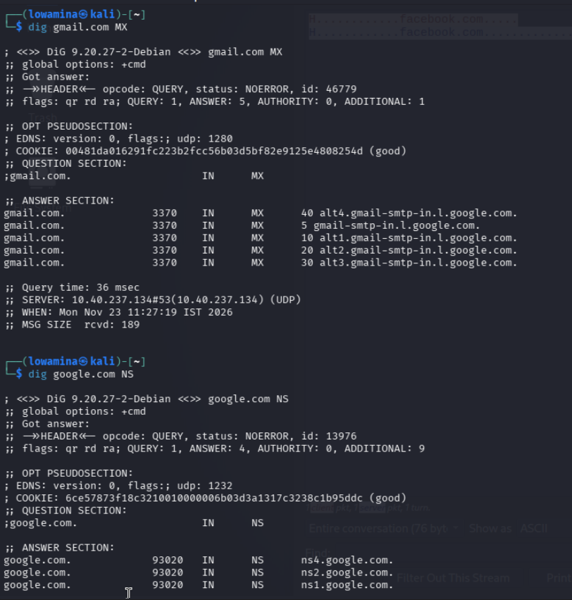
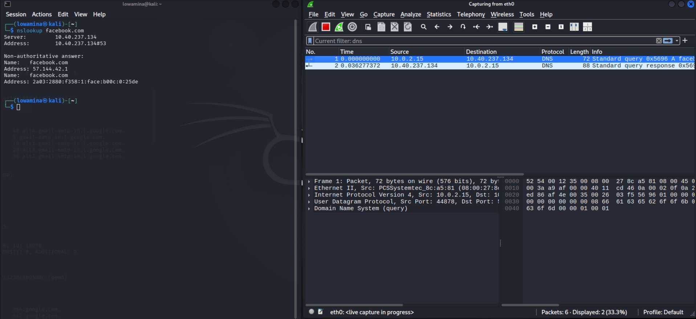
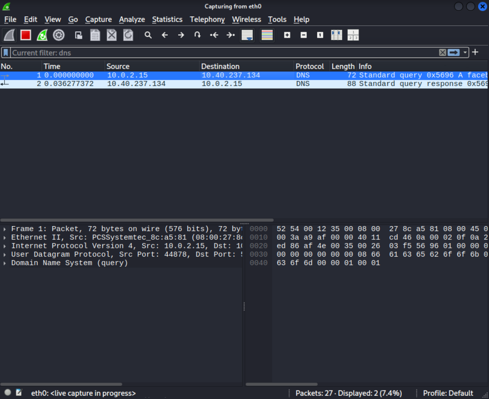
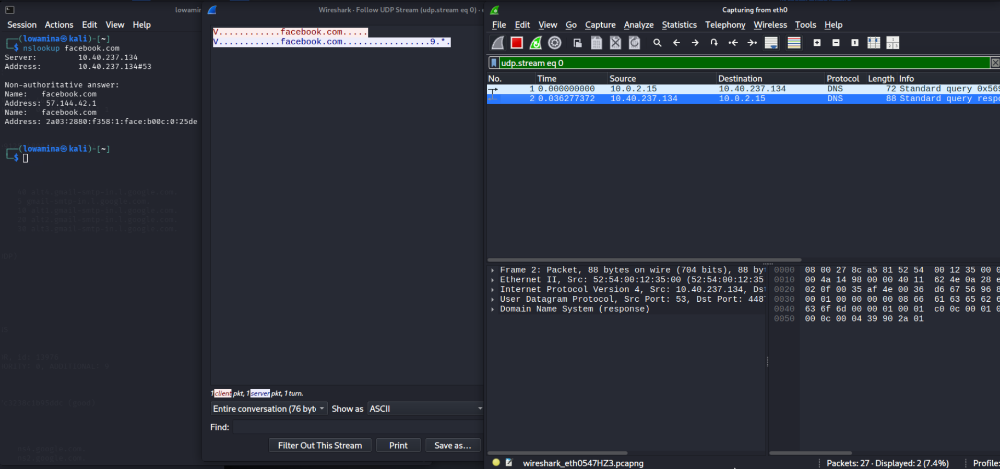

# Lab 03 — The DNS Resolution Journey: From Name to IP

**Goal:** show how **DNS (Domain Name System)** turns a human-friendly name like
`google.com` into the IP address a machine actually needs — and prove it with
real `nslookup`, `dig`, and Wireshark captures.

**The core idea:** People type **names**, not IP addresses. So DNS is the **first
step of almost every internet conversation** — the gateway protocol that runs
*before* anything else can happen. Type a name, and DNS must resolve it to an IP
before the browser can connect, before ARP finds a MAC, before routing begins.

**Scope:** all captures done on **my own Kali VM**, resolving public names. No
network I don't own is touched.

**Tools:** nslookup, dig, Wireshark.

---

## 1. Background — where DNS fits

Every device is reached by an **IP address**, but humans remember **names**. DNS
bridges that gap: **name → IP**.

It's the first link in the resolution chain this course builds up:

```
DNS   → name → IP      (www.google.com → 142.250.x.x)   ← THIS lab
ARP   → IP → MAC       (142.250.x.x → aa:bb:cc:...)
Route → hop by hop to the destination
```

So DNS is literally **step 1**. Without it, the name-based internet doesn't work.

> **Precise version:** DNS runs first *whenever a name is used*. It is skipped
> when the IP is already **cached** (the PC remembers recent lookups) or when you
> connect **directly by IP**. But as the gateway to the human-friendly internet,
> it is the first protocol in play.

### Key facts

| Fact | Detail |
|---|---|
| Port | **53** |
| Transport | usually **UDP** (fast, small queries); TCP for large transfers |
| Direction | **name → IP** (forward); also IP → name (reverse) |
| Security note | plain DNS is **unencrypted** — the queried name is visible on the wire |

---

## 2. Part A — nslookup (name → IP)

### Forward lookup (the main job)

```bash
nslookup google.com
```

<!-- SCREENSHOT 1: nslookup google.com showing the name resolving to an IP -->


### Reverse lookup (IP → name)

```bash
nslookup 8.8.8.8
```

<!-- SCREENSHOT 2: nslookup reverse lookup -->


### Querying a specific DNS server

```bash
nslookup google.com 1.1.1.1      # ask Cloudflare's DNS directly
```

<!-- SCREENSHOT 3: nslookup against a specific DNS server -->


---

## 3. Part B — dig (detailed lookups & record types)

`dig` shows richer detail and lets you query specific record types.

### A record (name → IPv4)

```bash
dig google.com
```

<!-- SCREENSHOT 4: dig A record showing the ANSWER section -->


### Other record types

```bash
dig gmail.com MX        # mail servers for the domain
dig google.com NS       # name servers
dig google.com +short   # just the answer
```

<!-- SCREENSHOT 5: dig MX / NS record output -->


### Common DNS record types

| Record | Purpose |
|--------|---------|
| **A** | name → IPv4 address |
| **AAAA** | name → IPv6 address |
| **MX** | mail servers for the domain |
| **NS** | name servers for the domain |
| **CNAME** | an alias pointing to another name |
| **PTR** | reverse: IP → name |

---

## 4. Part C — Wireshark (the real DNS packets)

The proof: capture an actual DNS query and its reply on **port 53**.

**Steps:**
1. Start a Wireshark capture on **eth0**.
2. Apply the display filter: `dns`
3. In a terminal, run: `nslookup example.com`
4. Two packets appear:
   - **Standard query** — the PC asking "what is the IP for example.com?"
   - **Standard query response** — the DNS server answering with the IP.

### The query and response pair

<!-- SCREENSHOT 6: Wireshark showing the DNS query + response (filter: dns) -->


### Inside the query (the question)

Expand the **Domain Name System** section of the query packet — it shows the
**name being asked** and destination **port 53**.

<!-- SCREENSHOT 7: expanded DNS query packet showing the name + port 53 -->


### Inside the response (the answer)

Expand the response packet's **Answers** section — it shows the resolved **IP
address** coming back.

<!-- SCREENSHOT 8: expanded DNS response packet showing the answer IP -->


---

## 5. Analysis — the journey, step by step

What the captures prove, in order:

```
1. I type a NAME:          example.com
2. DNS QUERY goes out:     "What is the IP for example.com?"  (UDP, port 53)
3. DNS RESPONSE comes back: "example.com is at 93.184.x.x"
4. Only NOW can the real conversation begin:
      → ARP resolves the IP to a MAC (for the local hop)
      → routing carries the packet to the destination
```

DNS is the **first protocol** in the exchange — the translator that must finish
before anything else can start.

### Security observation (cyber angle)

In the Wireshark capture, the **queried name is visible in plaintext**. This is a
real weakness:
- An attacker on the path can **see every site you look up** (even if the site
  itself uses HTTPS).
- **DNS spoofing / cache poisoning** can send a victim a **fake IP**, redirecting
  them to a malicious server.
- Defenses: **DNS over HTTPS (DoH)** / **DNS over TLS (DoT)** encrypt DNS queries
  so they can't be read or tampered with.

---

## 6. Conclusion

DNS is the **gateway to the internet**: whenever a name is used, it is the first
protocol that runs, turning a human-friendly name into the machine address every
other protocol depends on. The captures prove the full journey — a name goes out
on port 53, an IP comes back — and show that plain DNS is unencrypted, which is
why DoH/DoT exist.

---

## Ethics & scope

All lookups and captures were performed on **my own Kali VM**, resolving public
domain names — ordinary, legitimate DNS traffic. Capturing traffic on a network
you don't own or aren't authorised to test is illegal. The goal here is to
**understand** how name resolution works.
